# 🏋️ StudyFitness - Proyecto de Fitness Integral

## ¿Qué es?

**StudyFitness** es una aplicación de escritorio Java completa para el seguimiento y gestión integral de la salud y el fitness. Diseñada como un proyecto de portafolio, demuestra la combinación de tecnologías backend robustas con interfaces de usuario intuitivas y funcionalidades completas.

## ¿Qué hace? (Sin instrucciones de descarga)

### 🔐 **Autenticación y Gestión de Usuarios**
- **Registro de usuarios** con encriptación de contraseñas usando `crypt()` de PostgreSQL/pgcrypto en Supabase
- **Inicio de sesión** con verificación de credenciales
- **Perfiles de usuario** con actualización de nombre, edad, objetivo y género
- **Roles de acceso** (admin vs usuario) para control de permisos
- **Recuperación de foto de perfil** y fondo de menú personalizable

### 📊 **Seguimiento Nutricional**
- **Catálogo de alimentos** con información nutricional (calorías, proteínas)
- **Búsqueda por categorías** de alimentos disponibles
- **Registro y gestión** de alimentos en la base de datos
- **Visualización** de información nutricional detallada

### 🏃 **Rutinas y Ejercicios**
- **Generador de rutinas de ejercicio** con selección aleatoria
- **Modo duelo** de ejercicios para competir o desafiarse
- **Adivina el ejercicio** modo interactivo de aprendizaje
- **Mapas corporales** interactivos para visualizar grupos musculares
- **Actividades musculares** con información detallada

### 📝 **Evaluaciones y Quizzes**
- **Quizzes musculares** interactivos (preguntas de completar, verdadero/falso, opción múltiple)
- **Generación de PDFs** de resultados y calificaciones
- **Seguimiento de progreso** a través de sesiones de usuario

### 🗺️ **Visualización Corporal**
- **Panel de mapa corporal** con representación visual del cuerpo
- **Información grupal muscular** y detalles
- **Actividades de mapa interactivo** para engagement

### 💾 **Arquitectura y Tecnologías**
- **Frontend**: Interfaces Java Swing / GUI components
- **Backend**: PostgreSQL vía Supabase (Serverless PostgreSQL)
- **Base de datos**: Esquema completo con tablas para usuarios, alimentos, sesiones, resultados
- **Conectividad**: JDBC directa a Supabase con pooling de conexiones
- **Patrón DAO**: Data Access Object para operaciones de base de datos

## 🎯 Objetivo del Proyecto

StudyFitness sirve como demostración integral de habilidades en:
- Desarrollo de aplicaciones Java desktop
- Diseño e implementación de bases de datos relacionales
- Integración con servicios cloud (Supabase/PostgreSQL)
- Arquitectura de aplicaciones con patrón DAO
- Interfaces de usuario intuitivas y responsivas
- Manejo de seguridad (encriptación de contraseñas)

## 📁 Estructura del Proyecto

```
ProyectoStudyFitness/
├── src/                    # Código fuente Java
│   ├── database/           # DAOs y conexión Supabase
│   └── gui/                # Componentes e interfaces de usuario
├── build.xml               # Configuración de build (NetBeans)
├── dist/                   # Distribuible compilado
├── lib/                    # Dependencias del proyecto
└── sql/                    # Scripts y migraciones de base de datos
```

## 🚀 Características Destacadas

- **Sistema completo CRUD** para usuarios, alimentos y resultados
- **Encriptación segura** de contraseñas con pgcrypto
- **Interfaz multiventana** con navegación por roles
- **Generación de reportes** en PDF
- **Respaldo en la nube** via Supabase
- **Experiencia de usuario** gamificada con quizzes y retos

---
## 👥 Miembros del equipo

**Jamil Abraham Rivera Acosta** -
**Diego Moreno Rivera** -
**David Alejandro Tristán Contreras**

---

### 📺 Enlace a la Demo

**Video de demostración:** [https://youtu.be/zWSFaSdSO6g](https://youtu.be/zWSFaSdSO6g)

---

## 📸 Capturas de pantalla

<details> <summary><strong>Usuario > Juegos</strong></summary> <br>

| ArmA Rutina | Duelo Ejercicios | Encuentra Error |
|---|---|---|
| 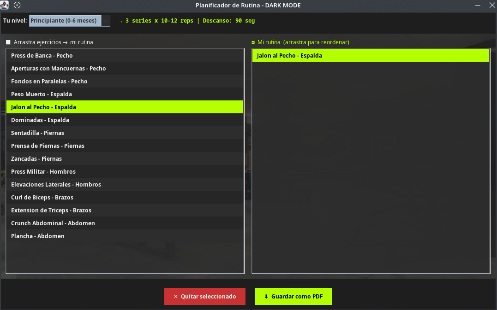 | 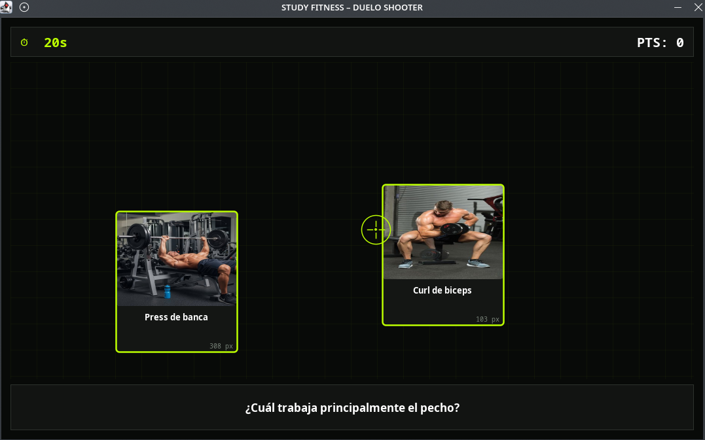 | 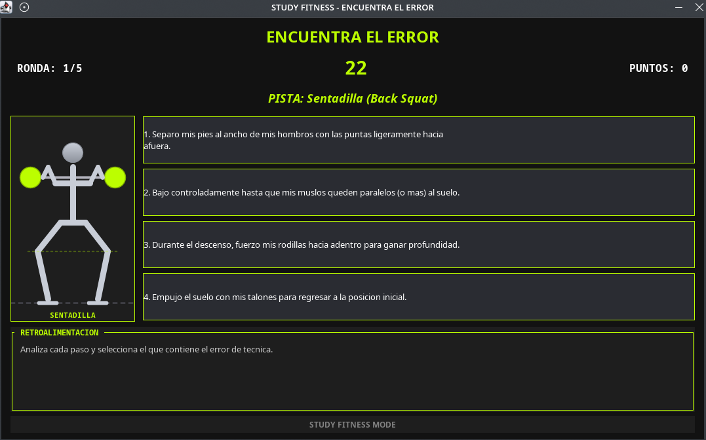 |

| Laberinto | Mapa Interactivo | Quiz Grupos |
|---|---|---|
| 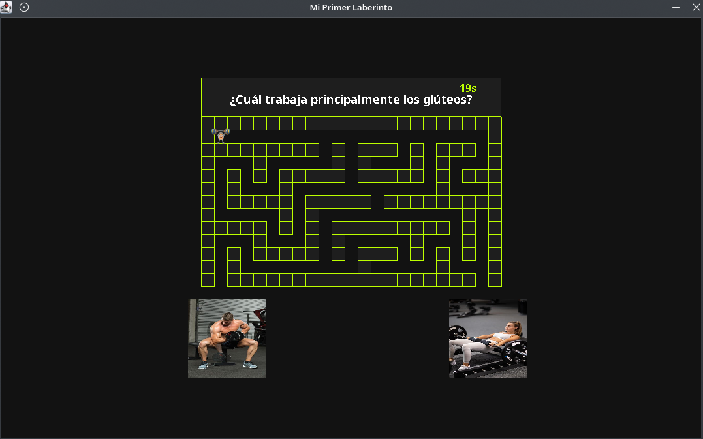 | 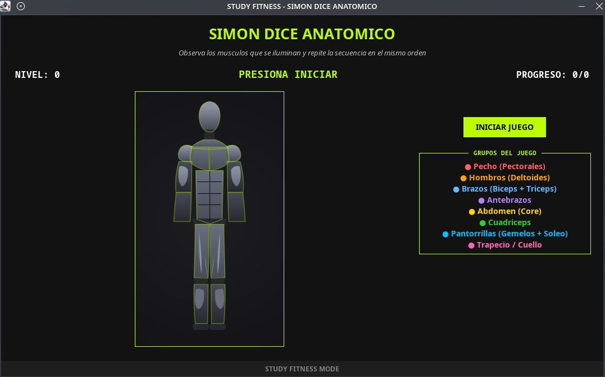 | 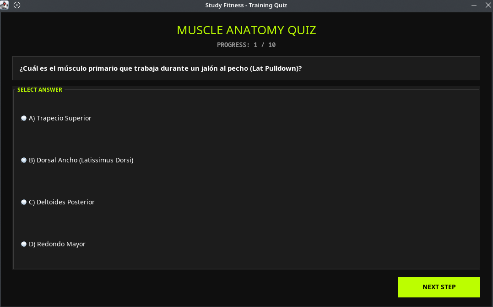 |

</details> <details> <summary><strong>Usuario > Menú</strong></summary> <br>

| Menú Usuario |
|---|
| 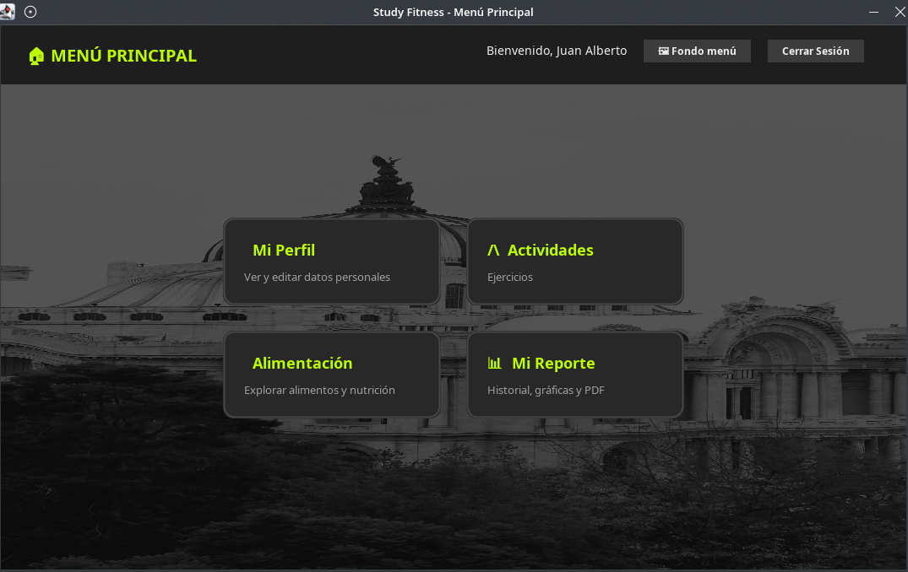 |

</details> <details> <summary><strong>Usuario > Alimentación</strong></summary> <br>

| 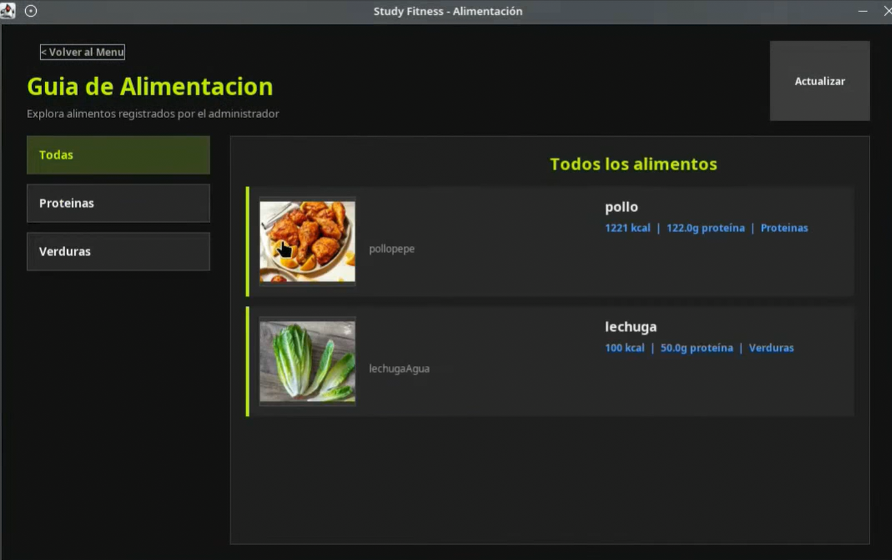 |
|---|
| *Seción de Alimentación y Nutrición* |
</details> <details> <summary><strong>Administrador > Panel</strong></summary> <br>

| 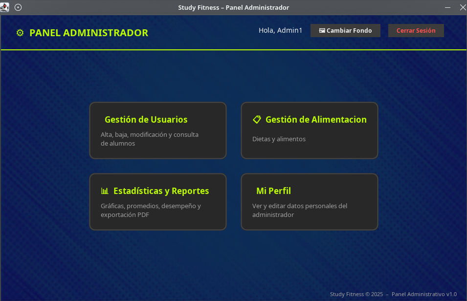 |
|---|
| *Panel de control general para administración* |

</details> <details> <summary><strong>Administrador > Usuarios</strong></summary> <br>

| 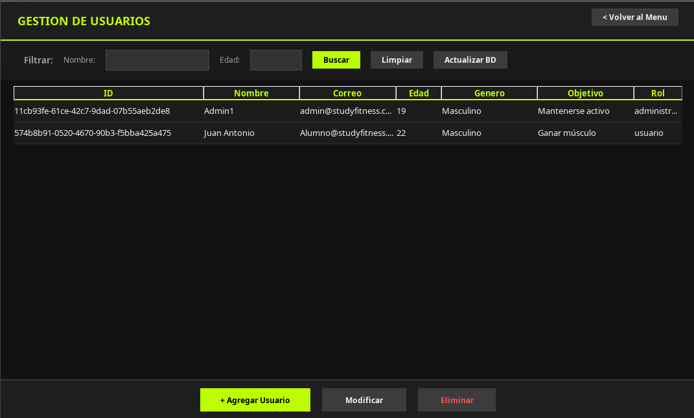 |
|---|
| *Gestión y configuración de usuarios del sistema* |

</details> <details> <summary><strong>Administrador > Reportes</strong></summary> <br>

| 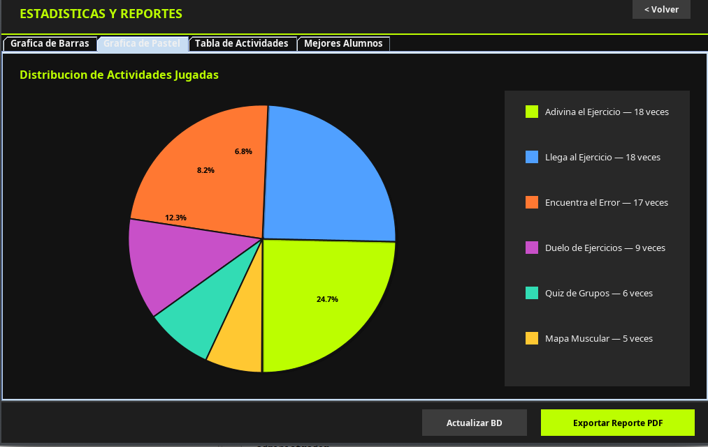 |
|---|
| *Generación de reportes y análisis de datos* |

</details> <details> <summary><strong>Login > Inicio de Sesión</strong></summary> <br>

| 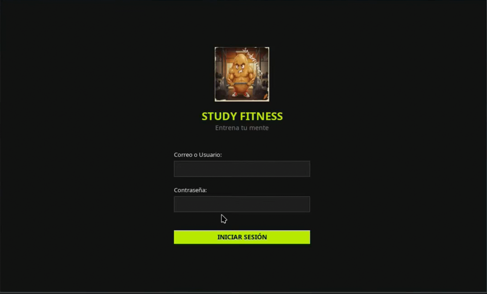 |
|---|
| *Formulario de autenticación general* |
</details>

---

*Este proyecto fue desarrollado como demostración de portafolio, mostrando competencias en desarrollo de software full-stack, diseño de bases de datos y creación de aplicaciones de escritorio.*
